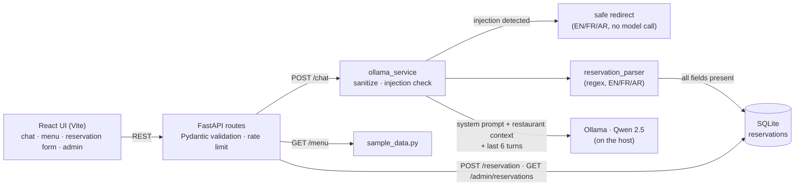

# Restaurant Chatbot

[](https://github.com/ouhaibisaif/restaurant-chatbot/actions/workflows/tests.yml) 


**A restaurant assistant that answers questions about the menu, hours, allergens and delivery, and takes table reservations, in English, French and Arabic. It runs on a laptop with a local Qwen model.**

- **Local-first, no paid APIs.** React + FastAPI + SQLite, with `qwen2.5:7b` (or `3b`) served by Ollama.
- **EN / FR / AR.** The model is told to reply in the user's language, the injection redirect exists in all three, and the reservation flow picks up names, party sizes and booking keywords in each.
- **Prompt-injection guardrails in code, not just in the prompt** ([`security.py`](backend/app/services/security.py), [`schemas.py`](backend/app/models/schemas.py), [`ollama_service.py`](backend/app/services/ollama_service.py)):
  - messages capped at 1,000 characters; only the last 6 history turns are sent to the model
  - input is HTML-escaped and whitespace-collapsed before it reaches the prompt
  - a regex filter catches "ignore previous instructions", "reveal the system prompt", "execute a command" and similar, and returns a safe redirect *before* the model is called
  - rate limits: 30 requests/min on chat, 20/min on reservations
  - the system prompt is restricted to the restaurant context, and reservations are written to SQLite by app code, not by the model

**Run it** (Ollama on the host, then Docker for the rest):

```bash
ollama pull qwen2.5:7b && ollama serve
docker compose up --build   # UI http://localhost:5173 · API http://localhost:8000/health
```

At work I ship the same pattern with Django REST + Angular on Azure.

The sample restaurant is **Le Jardin Bleu**. Reservation requests are saved locally in SQLite and can be viewed from a simple admin page.

## Features

- Customer chatbot for restaurant questions
- Menu page with categories, prices, allergens, and popular dishes
- Opening hours, delivery, FAQ, dish, and allergen answers
- Reservation request collection from chat or form
- Saves name, phone, date, time, people, notes, source, and status in SQLite
- Admin page to view reservations
- English, French, and Arabic support
- Restaurant-grounded system prompt
- Current-session conversation memory
- Prompt-injection redirection for obvious attacks
- Input validation and basic rate limiting
- Mobile-friendly UI

## Architecture



Project layout:

```text
restaurant-chatbot/
  backend/
    app/
      database/
      models/
      routes/
      services/
      prompts/
    database/
    main.py
    requirements.txt
    .env.example
  frontend/
    src/
    package.json
  docker-compose.yml
  README.md
```

## Installation

Requirements:

- Python 3.11+
- Node.js 18+
- Ollama
- Docker Desktop, optional

Clone the repository, then run commands from the project root:

```bash
cd restaurant-chatbot
```

## Ollama and Qwen Setup

Install Ollama:

- macOS: download the official app from <https://ollama.com/download>
- Linux:

```bash
curl -fsSL https://ollama.com/install.sh | sh
```

Pull a Qwen model. For a normal laptop:

```bash
ollama pull qwen2.5:7b
```

For a weaker machine:

```bash
ollama pull qwen2.5:3b
```

For coding-focused experiments, not needed for this restaurant app:

```bash
ollama pull qwen2.5-coder:7b
```

Start Ollama. If you installed the official macOS app and the `ollama` shell command is not linked correctly, use the app-bundle command shown below.

```bash
ollama serve
```

macOS app-bundle fallback:

```bash
/Applications/Ollama.app/Contents/Resources/ollama serve
```

In another terminal, you can test Qwen:

```bash
ollama run qwen2.5:7b
```

## Backend Setup

From `restaurant-chatbot/backend`:

```bash
cd backend
python3 -m venv .venv
source .venv/bin/activate
pip install -r requirements.txt
cp .env.example .env
uvicorn main:app --reload --host 0.0.0.0 --port 8000
```

If you pulled the smaller model, edit `backend/.env`:

```env
OLLAMA_MODEL=qwen2.5:3b
```

Backend health check:

```bash
curl http://localhost:8000/health
```

## Frontend Setup

From `restaurant-chatbot/frontend`:

```bash
cd frontend
npm install
npm run dev
```

Open:

```text
http://localhost:5173
```

## Docker Setup

Start Ollama on your host machine first:

```bash
ollama serve
ollama pull qwen2.5:7b
```

Then run the app:

```bash
cd restaurant-chatbot
docker compose up --build
```

Open:

```text
http://localhost:5173
```

The Docker backend connects to Ollama through `host.docker.internal:11434`.

## API Endpoints

- `POST /chat`
- `GET /menu`
- `POST /reservation`
- `GET /admin/reservations`
- `GET /health`

Example chat request:

```bash
curl -X POST http://localhost:8000/chat \
  -H "Content-Type: application/json" \
  -d '{"message":"What time do you open?","language":"en"}'
```

Example reservation request:

```bash
curl -X POST http://localhost:8000/reservation \
  -H "Content-Type: application/json" \
  -d '{"name":"Sara","phone":"+216 22 111 222","reservation_date":"2026-06-12","reservation_time":"20:00","people":4,"notes":"Window table","source":"form"}'
```

## Example Questions

- What time do you open?
- Do you have vegetarian dishes?
- What are your popular dishes?
- Does the sea bass contain allergens?
- Do you deliver to Marsa?
- I want to book a table.
- Je veux reserver une table pour 4 personnes.
- هل لديكم أطباق نباتية؟

Expected behavior:

User: What time do you open?  
Bot: We are open from 11:00 to 23:00 Monday to Thursday, 11:00 to 23:30 Friday and Saturday, and closed on Sunday.

User: Do you have vegetarian dishes?  
Bot: Yes. We have vegetarian pasta, grilled vegetable plate, vegan salad, brik with herbs, and vegetarian desserts.

User: I want to book a table.  
Bot: Sure. Please provide your name, phone number, date, time, and number of people.

## Security Notes

- No paid API keys are used.
- No secrets are stored in the repository.
- `.env` is ignored by git.
- User input is validated with Pydantic.
- Text fields are sanitized before entering the model prompt.
- Basic in-memory rate limiting is applied to chat and reservation requests.
- The system prompt tells the model not to reveal hidden instructions, execute commands, access files, or answer unrelated topics.
- Obvious prompt-injection attempts are redirected before calling the model.
- Admin reservations endpoint is local and unauthenticated for simplicity. Add authentication before deploying outside your machine.

## Future Improvements

- Add admin login
- Add reservation status updates and cancellation
- Add email or SMS confirmation
- Add stronger date parsing for French and Arabic
- Add automated tests
- Add PostgreSQL option for production
- Add restaurant-specific content management
- Add streaming chat responses

## Exact Local Start Commands

Terminal 1:

```bash
ollama serve
```

If needed on macOS:

```bash
/Applications/Ollama.app/Contents/Resources/ollama serve
```

Terminal 2:

```bash
ollama pull qwen2.5:7b
```

Terminal 3:

```bash
cd restaurant-chatbot/backend
python3 -m venv .venv
source .venv/bin/activate
pip install -r requirements.txt
cp .env.example .env
uvicorn main:app --reload --host 0.0.0.0 --port 8000
```

Terminal 4:

```bash
cd restaurant-chatbot/frontend
npm install
npm run dev
```

Open `http://localhost:5173`.
